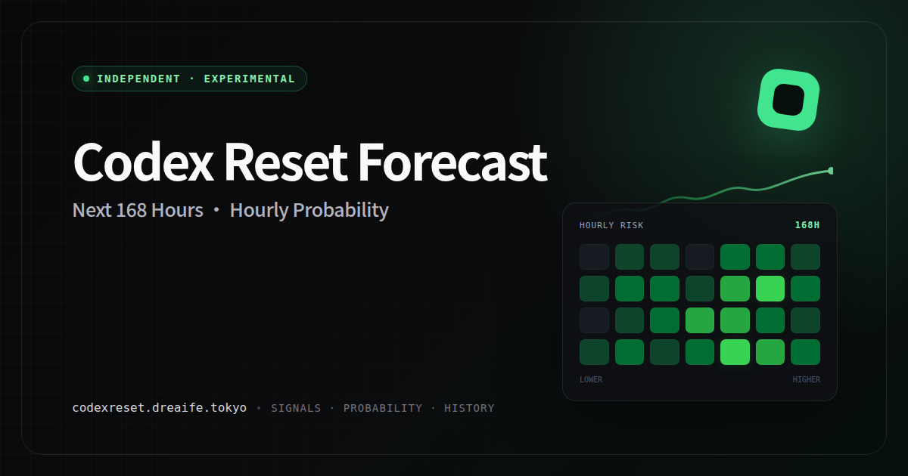

# Codex Reset Forecaster

Hourly probability forecasts for the next Codex usage-limit reset announcement.



Codex usage limits are sometimes reset or refilled for everyone, and the reset is
announced publicly on X. This project collects those public posts and related
context. It then forecasts, hour by hour for the next seven days, how likely a
qualifying reset announcement is within the next four hours.

**Live site:** <https://codexreset.dreaife.tokyo/en> (Chinese:
<https://codexreset.dreaife.tokyo/>)

## What you get

- **Seven-day forecast page.** A 7 × 24 heatmap plus next-4-hour and
  next-24-hour views. All three come from the same 168-hour forecast, and each cell
  shows its exact probability.
- **Confirmed reset history.** A separate page (`/en/accuracy`) that lists only
  confirmed resets and links to their sources.
- **Recent evidence.** The source account's timeline and related context, such as
  Codex outages and recoveries or competing model releases. This evidence is shown
  separately from the reset probability.
- **Notifications:**
  - Atom feeds. `/feed.xml` carries authority announcements and confirmed resets.
    `/feeds/experimental.xml` also carries probability alerts.
    `/feeds/probability.xml` takes your own horizon and threshold.
  - Web Push in the browser, opt-in, for deployments that have set it up.
  - Telegram bots, in Chinese
    [@codex_reset_7day_bot](https://t.me/codex_reset_7day_bot) and English
    [@codex_reset_7day_en_bot](https://t.me/codex_reset_7day_en_bot). For example,
    `/subscribe probability 24h 60%` alerts you when the 24-hour probability
    passes 60%.
- **JSON API.** Read-only endpoints such as `/api/forecast/current`,
  `/api/history/results`, `/api/health`, and `/api/readiness`.

## Important notes

- **This is not official data.** The forecast target is a public statement from a
  configured authority account (currently Tibo Sottiaux on X) saying that a
  platform-wide Codex reset has completed. The project does not see OpenAI's
  backend and cannot detect every physical reset. Announcements of planned
  resets, rumors, and model output are not counted as resets. It knows nothing
  about your own account's quota.
- **The model is provisional, not validated.** The live model is fitted on the
  history available so far and is labeled `provisional` on the site. Accuracy
  claims such as 80% event recall are not made until a strict walk-forward test
  passes. That test needs at least 1,008 evaluated hourly windows and 20 resets.
  Until then, read the numbers as a rough indicator.

## Quick start

Requires Node.js 22 or newer.

```bash
npm install
npm test
npm run validate
```

### Demo with synthetic data

```bash
RESET_DATA_DIR=/tmp/reset-forecaster-demo npm run demo:seed
RESET_DATA_DIR=/tmp/reset-forecaster-demo npm run demo:start
```

Then open <http://127.0.0.1:8787/>. The demo checks that the pipeline works. Its
scores are labeled `SYNTHETIC DEMO` and say nothing about real accuracy.

### Live profile

```bash
export RESET_CONFIG="$PWD/config/tibo-authority-live.json"
export RESET_DATA_DIR="$PWD/data/tibo-authority"
node src/cli.mjs ingest-archive
node src/cli.mjs process
node src/cli.mjs status
RESET_SCHEDULER_ENABLED=true npm start
```

Without `RESET_SCHEDULER_ENABLED=true`, `npm start` only serves data that is
already saved. With it, the service collects and forecasts every 10 minutes. A
fresh data directory answers `503 waiting` until enough history and outcome
coverage exist. See [operations](docs/operations.md) for live X credentials,
RSSHub, and the source-stability rules.

### Docker

```bash
cp .env.example .env
docker volume create codex-reset-forecaster-data-v1
docker compose up --build -d
curl http://127.0.0.1:8799/api/readiness
```

The service listens on loopback port 8799. Set `RESET_PUBLIC_BASE_URL` in `.env`
to your own public URL before enabling publication. Add `--profile telegram` (and
`--profile telegram-en`) to run the bots once their
token files are configured. `compose.cloudflare.yaml` attaches the service to a
Cloudflare Tunnel network. `compose.lite.yaml` runs a serve-only instance from an
exported model; see “Lite serving mode” in [operations](docs/operations.md).

## Configuration

- **Profiles** live in `config/`. `default.json` is the provider-neutral baseline,
  `tibo-authority-live.json` is the live deployment target, and
  `archive-evaluation.example.json` and `live.example.json` are starting points.
  Select one with `RESET_CONFIG`.
- **Environment variables** for Docker are listed and commented in
  `.env.example`: port, data volume, scheduler, public base URL, Web Push,
  Telegram, and the optional X Search Gateway and semantic assistance.
- **Secrets** are never placed in config or `.env`. Each one is read from a file,
  using mode `0400`/`0600` and the `*_TOKEN_FILE` / `*_KEYS_FILE` variables, and
  Compose mounts that file read-only.
- **Web Push and Telegram** stay disabled until their key or token files exist. A
  public Web Push deployment also needs edge rate limiting and an anti-automation
  challenge. See [notifications](docs/notifications.md).

## Project structure

```text
src/providers/      Source adapters (X, RSSHub, X Search Gateway, archive, fixtures)
src/pipeline/       Relevance, extraction, linking, outcomes, coverage
src/model/          Features, hourly hazard model, training, evaluation, forecast
src/notifications/  Publication ledger, Atom feeds, subscription rules
src/web/, public/   HTTP server and website
src/telegram/       Telegram bot runtime
src/cli.mjs         Command-line entry point
config/             Versioned deployment profiles
schemas/, examples/ JSON Schemas and example records
docs/               Design, contracts, operations, and status
test/               Node test suite
```

Further reading:

- [Design baseline and current decisions](docs/design.md)
- [Product requirements](docs/product-requirements.md)
- [Architecture](docs/architecture.md)
- [Data contract](docs/data-contract.md)
- [Model contract](docs/model-contract.md)
- [Notifications](docs/notifications.md)
- [Operations](docs/operations.md)
- [Implementation status and contract versions](docs/implementation-status.md)
- [Personal quota optimizer (deferred)](docs/personal-optimizer.md)

## License

Licensed under the [Apache License 2.0](LICENSE). The bundled GitHub mark has its
own attribution in [THIRD_PARTY_NOTICES.md](THIRD_PARTY_NOTICES.md).
